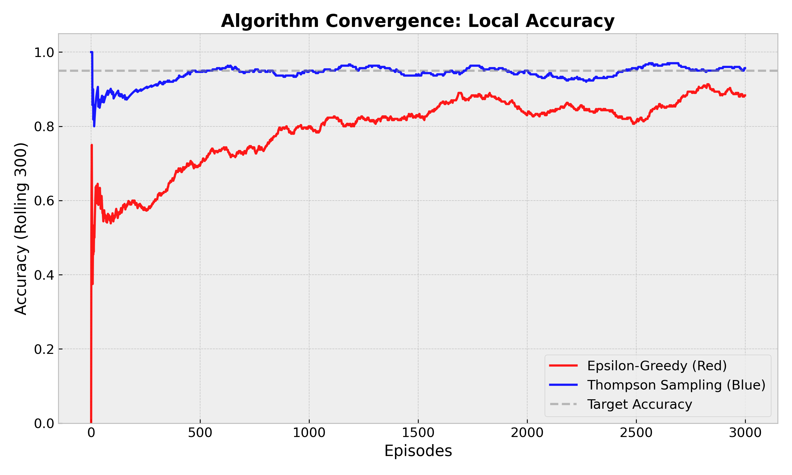
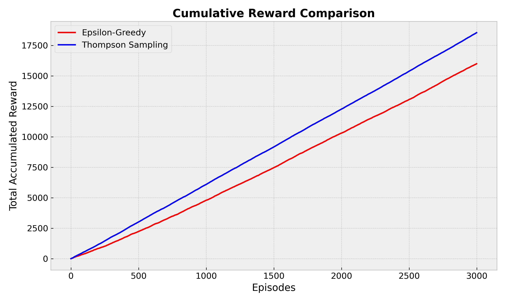
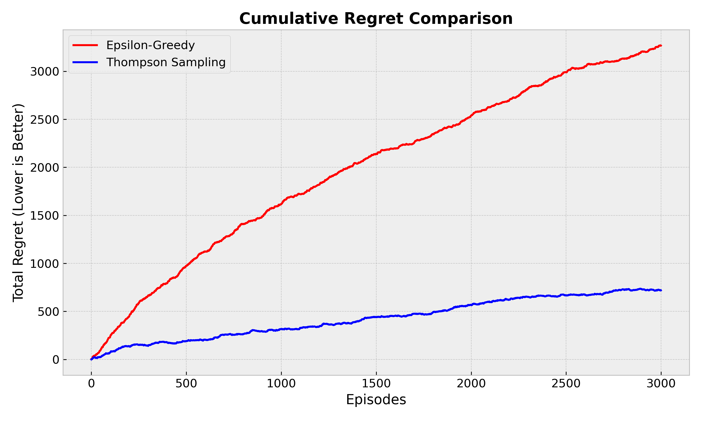
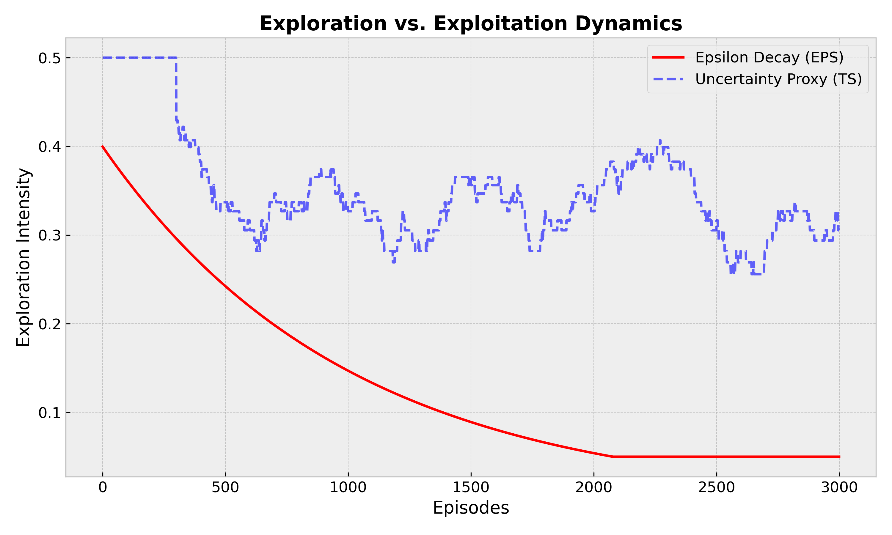

# Research Paper Plots: Thompson Sampling vs. Epsilon-Greedy

For a research paper in Reinforcement Learning (RL) or Multi-Armed Bandits (MAB), the following graphs are standard requirements to demonstrate algorithm performance and theoretical properties.

## Visual Comparison Summary

| Plot | Description |
| :--- | :--- |
|  | **Learning Curve**: Local Accuracy (Rolling Average) |
|  | **Cumulative Reward Comparison** |
|  | **Cumulative Regret Comparison** |
|  | **Exploration Strategy Analysis** |

---

## Detailed Analysis of Required Graphs

### 1. Learning Curve (Local Accuracy)
*   **Color Key**: **Red: Epsilon-Greedy**, **Blue: Thompson Sampling**
*   **Purpose**: Shows how quickly the model "learns" to recommend the correct items.
*   **What to look for**: Thompson Sampling (TS) usually converges faster and reaches a higher steady-state accuracy because it uses a probabilistic model of uncertainty rather than a fixed random exploration rate.

### 2. Cumulative Reward
*   **Color Key**: **Red: Epsilon-Greedy**, **Blue: Thompson Sampling**
*   **Purpose**: Demonstrates the total utility generated by the system over time.
*   **What to look for**: The slope of the line represents the "income rate" of the algorithm. A steeper slope for TS indicates it is collecting more rewards by choosing better movies more often.

### 3. Cumulative Regret (Critical for RL Papers)
*   **Color Key**: **Red: Epsilon-Greedy**, **Blue: Thompson Sampling**
*   **Purpose**: Regret is the difference between the *optimal* possible reward and the *actual* reward. In MAB theory, we want regret to be **logarithmic** (slowing down over time).
*   **What to look for**: Epsilon-Greedy often shows **linear regret** (it keeps exploring forever at a fixed rate $\epsilon$), while Thompson Sampling typically shows **sub-linear/logarithmic regret** as it becomes more certain about the best arms.

### 4. Exploration Analysis
*   **Color Key**: **Red: Epsilon-Greedy**, **Blue: Thompson Sampling**
*   **Purpose**: Visualizes the internal logic of the algorithms.
*   **What to look for**: 
    *   **Epsilon-Greedy**: Shows the decay of $\epsilon$ over time (decreasing randomness).
    *   **Thompson Sampling**: Shows a "Uncertainty Proxy" (based on variance). As the model learns, the uncertainty drops, meaning it transitions naturally from exploration to exploitation without a hard-coded decay rule.

---

**Research Note:** When writing your paper, emphasize that Thompson Sampling is "Bayesian" in nature. It doesn't just guess; it samples from a posterior distribution, allowing it to explore more intelligently in the early stages and exploit more aggressively once confident.
